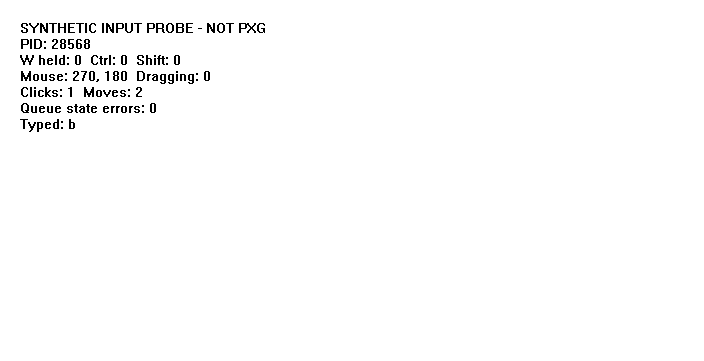
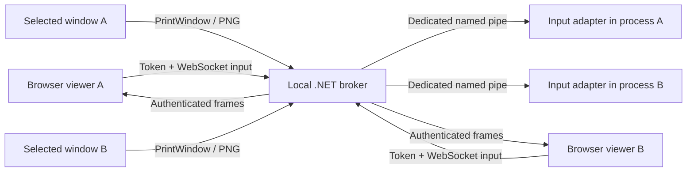

# SandVNC

**One sandbox. One application. Your own controls.**

Imagine letting someone use a Windows application while you keep working on the same computer. They move their own cursor, hold their own keys, and see the application you chose. A second person can do the same in another sandbox.

That is the goal of SandVNC: independent, application-focused remote access built around Sandboxie. This repository opens the working parts, the failed experiments, and the remaining questions so we can build the next step together.

**Today: an experimental Windows prototype with a local browser viewer.** Two native test applications already accept independent input. Full remote access, application compatibility, and host-file isolation are still unfinished. Despite its name, SandVNC does **not** implement the VNC/RFB protocol; conventional VNC clients cannot connect.

[Try the demo](#try-the-demo) · [See the evidence](REPORT.md) · [Pick a contribution](#build-the-next-step-with-us) · [Original Sandboxie request](https://github.com/sandboxie-plus/Sandboxie/issues/4155)

## The question that started it

In August 2024, [Kizuno18 asked the official Sandboxie project](https://github.com/sandboxie-plus/Sandboxie/issues/4155) for remote access to a sandboxed application while protecting the files around it. The follow-up clarified the desired experience: access one application from another device. [The discussion also explored one VNC server per sandboxed desktop](https://github.com/sandboxie-plus/Sandboxie/issues/4155#issuecomment-2304113187).

SandVNC explores process-local input and selected-window capture as a route toward that experience. It is an independent community experiment, with no claim of endorsement or affiliation with Sandboxie.

The challenge is concrete: Windows applications often share assumptions about keyboard state, focus, the mouse, and the desktop. Giving two people two images is only the beginning. Their input, reconnects, dialogs, and failures also need to stay independent.

## What works, and what still needs you

| Capability | Evidence and current boundary |
| --- | --- |
| Two independent input sessions | Synthetic Win32 tests cover simultaneous W holds, independent release, modifiers, typing, clicking, and dragging. |
| Reconnect and stuck-key handling | Tests cover controller takeover, disconnect, missing heartbeat, stale sequences, and window replacement. |
| Application-only capture | The demo captures each selected window. Capture has a latest-frame slot and pauses when there are no readers. |
| Transport inside Sandboxie | Recorded tests passed with native probes in `SandVnc_A` and `SandVnc_B`, using per-box IPC namespaces. |
| Experimental PXG client transport | A later record reports separate adapter key state in two client processes. Its `applied` counters remain zero: this does not prove the game consumed input. |
| Complete real-application interaction | Unverified. Raw Input, auxiliary windows, rendering, and several input methods remain blockers. |
| Remote deployment and file isolation | Unimplemented or unverified. The broker binds only to `127.0.0.1`; this is not a public remote-access service. |

These are actual pixels from the synthetic test application, not a game screenshot or a product mockup:



The [technical report](REPORT.md) separates historical observations from acceptance criteria. [Manual acceptance procedures](tests/manual.md) describe what still must pass before claiming two usable remote sessions.

## Try the demo

Use a Windows machine with an interactive desktop and these tools on `PATH`:

- PowerShell 7, Git, and CMake 3.25 or newer.
- Visual Studio 2022 Build Tools with the C++ workload and a Windows SDK. Native targets currently build as x86.
- .NET 10 SDK.
- Node.js with built-in `fetch` and `WebSocket`, for the tests.

The synthetic demo does not require Sandboxie or a game client. It starts two purpose-built test applications and a loopback broker.

```powershell
git clone https://github.com/Kizuno18/SandVNC.git
cd SandVNC
pwsh -NoProfile -File ./scripts/build.ps1
pwsh -NoProfile -File ./scripts/start-demo.ps1
```

The demo command stays in the foreground. In another PowerShell terminal in the repository:

```powershell
$demo = Get-Content -Raw ./runtime/viewers.json | ConvertFrom-Json
$demo.viewers | Select-Object name, url
```

Open each URL in a separate browser window on this computer and select **Connect / take control**. Click the application image and try typing or moving the mouse. The viewer deliberately disconnects when its window loses focus; use the automated test to exercise truly simultaneous input.

The URLs contain session credentials. Keep `runtime/viewers.json` private. Reopening the original URL allows controller takeover; a page refresh after the viewer removes the URL fragment loses that page's token. Disconnecting a viewer leaves the application running.

Stop the demo with:

```powershell
pwsh -NoProfile -File ./scripts/stop-demo.ps1
```

The build downloads [MinHook v1.3.4](https://github.com/TsudaKageyu/minhook/tree/v1.3.4), verifies commit `c3fcafdc10146beb5919319d0683e44e3c30d537`, and keeps generated files in ignored directories. No third-party client executable or game assets are distributed.

## Reproduce the tests

Stop an existing demo first, then run:

```powershell
pwsh -NoProfile -File ./scripts/test.ps1
```

The script builds, starts two native probes, measures idle and frame-reader costs, checks capture ordering, runs 30 repeated independent-hold cycles, and executes 13 concurrency/lifecycle checks. It then stops its demo processes. Use `-SkipBuild` only after a successful build.

Results and screenshots go into `evidence/`; runtime outputs are ignored by Git. Committed, reviewed samples live under [`evidence/reference/`](evidence/reference). Node HTTP/WebSocket tests exercise the broker and native targets; they do not automate browser interaction or measure input-to-photon latency.

There is no configured automated lint suite or CI workflow yet. Check whitespace with `git diff --check`. Native builds and these integration tests require Windows; a Linux container cannot replace the Win32 desktop environment they exercise.

## How it works



The C++ adapter uses MinHook inside the target to virtualize selected Win32 keyboard, cursor, focus, and message APIs. Each process keeps its own input state. It does not use `SendInput` or move the host cursor. This API coverage is limited; it is not an OS-wide input isolation guarantee.

The C# broker verifies the pipe client's PID, executable, process creation time, and window ownership. A token selects a server-owned session; viewers cannot choose arbitrary processes. Controller takeover advances an epoch and releases held input, while cleanup from an old connection cannot revoke its replacement. Broker and adapter timers release input when their controllers disappear.

Each capture thread maintains one latest frame. Slow readers do not accumulate a frame backlog, and HTTP writes do not hold the input lock. Frames record capture-start time and the input acknowledgment preceding capture. An acknowledgment does not prove an application has rendered the input. `PrintWindow` is synchronous, so a stalled target remains an unresolved capture risk.

Key files: [`native/adapter.cpp`](native/adapter.cpp), [`native/protocol.h`](native/protocol.h), [`src/BoxSession.cs`](src/BoxSession.cs), [`src/Program.cs`](src/Program.cs), and [`src/viewer.html`](src/viewer.html).

## Sandboxie and real-client experiments

These are separate from the demo. [Provisioning instructions](config/README.md) explain the two test boxes, the generated configuration fragment, and the explicit `-Apply` step that changes the installed Sandboxie configuration. Read them before running a boxed test.

Once those test boxes exist:

```powershell
./out/SandVnc.exe --box-transport-check
```

This launches synthetic probes in the two boxes and checks independent key state. It does not prove filesystem isolation.

Optional client inspection requires your own legally obtained client and tool paths:

```powershell
./scripts/inspect-client.ps1 -Client 'C:\path\to\pxgme32.exe' -Dumpbin 'C:\path\to\dumpbin.exe'
node ./scripts/inspect-sdl.mjs 'C:\path\to\pxgme32.exe'
./out/SandVnc.exe --inspect
```

The native client launcher and the `--client-demo` / `--client-transport-check` switches are unfinished diagnostics tied to `runtime/client/win32/pxgme32.exe` and the two test boxes. A historical Defender intervention occurred during this experiment. A later log records recovery of the copied executable, followed by a transport-only result. Neither event validates safety or compatibility. The preparation script remains blocked by the preserved intervention record; this project provides no antivirus exclusion or bypass workflow.

## Boundaries before remote access

- The listener is local HTTP only. There is no supported LAN/WAN deployment, TLS setup, account system, or VNC/RFB implementation.
- A sandboxed process may still read host files under its effective Sandboxie policy. Copy-on-write storage alone does not protect those files. Open/save dialogs, exports, URI handlers, and child processes need explicit negative tests.
- Clipboard hooks cover selected Win32 APIs only. They do not establish complete clipboard or data-exfiltration isolation.
- Raw Input is rejected. DirectInput, IME, wheel/touch support, native controls, multiple input threads, and general SDL compatibility are unsupported or unverified.
- Additional visible top-level windows stop the session. Destroying a bound window retires that session. Dialog support must be designed and tested rather than hidden to make a demo pass.
- Physical administrator input, hostile local processes, actual game stalls, browser presentation latency, and congested remote networks have not received full acceptance testing.

## Build the next step with us

You do not need to solve Windows input isolation to make a useful first contribution. Pick one result another person can reproduce:

- **Try the quick start.** Report the exact failed command, Windows/tool versions, and a sanitized error if a fresh clone does not work.
- **Make one interaction measurable.** Add a small native probe for an unsupported input method or dialog and state the expected result.
- **Test the browser.** Help cover focus changes, reconnects, scale changes, and input-to-visible-frame timing.
- **Review an isolation boundary.** Turn a filesystem, clipboard, child-process, or token concern into a reproducible test.
- **Improve capture or compatibility.** Compare a proposed change against the existing fixtures, keeping failure behavior explicit.

Our next milestone is one reproducible end-to-end application session with a tested isolation policy. Two independently usable sessions follow from evidence, not from a checkbox in this README.

[Open an issue](https://github.com/Kizuno18/SandVNC/issues/new) with the piece you want to own, or send a focused pull request. A clear bug reproduction, a failed experiment with evidence, and a small documentation fix all move the project forward. See [CONTRIBUTING.md](CONTRIBUTING.md) for the workflow.

## License and acknowledgments

SandVNC's original code is available under the [MIT License](LICENSE). MinHook retains its own [license notices](MINHOOK-LICENSE.txt); its source is fetched during the build. Sandboxie and any client applications remain separate projects with their own licenses. No client assets, installed Sandboxie configuration, session tokens, or private sandbox data belong in this repository.

Thanks to the [Sandboxie project](https://github.com/sandboxie-plus/Sandboxie), [MinHook](https://github.com/TsudaKageyu/minhook), and everyone willing to turn an interesting question into a reproducible result.
